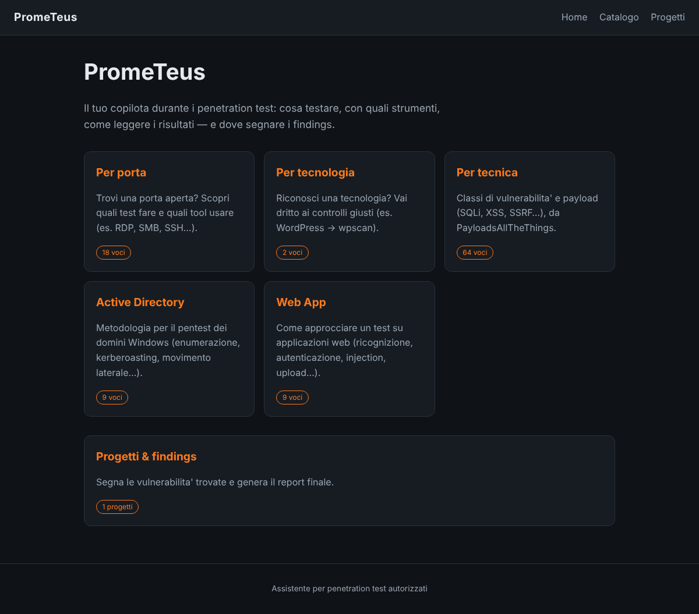
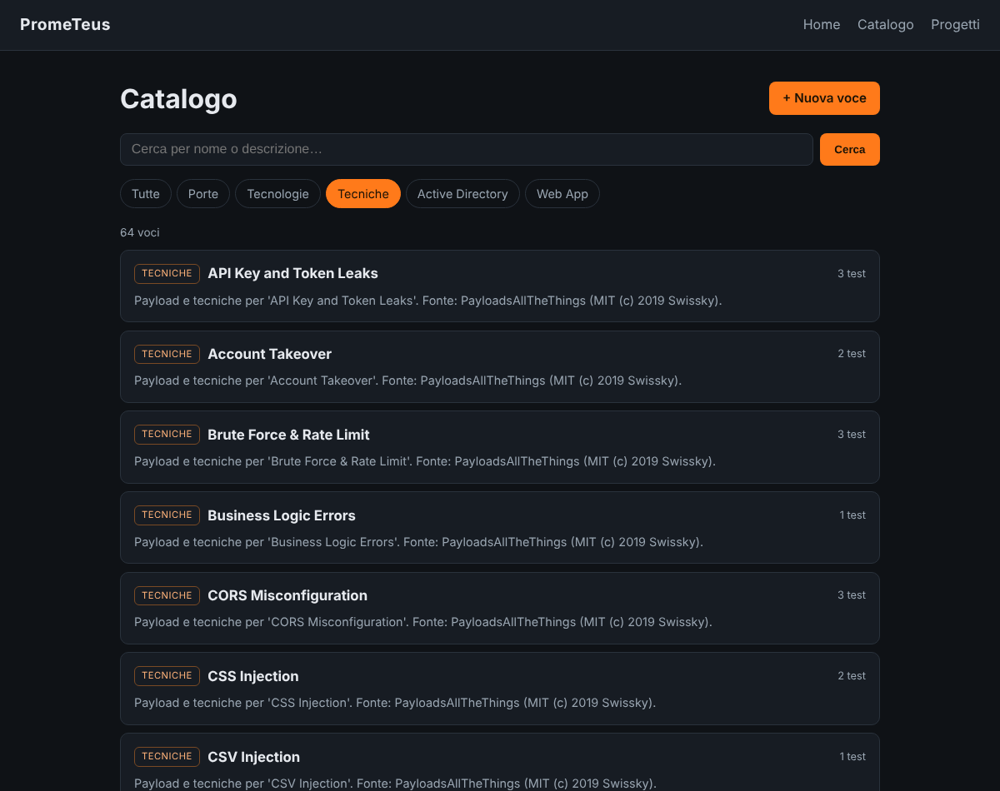
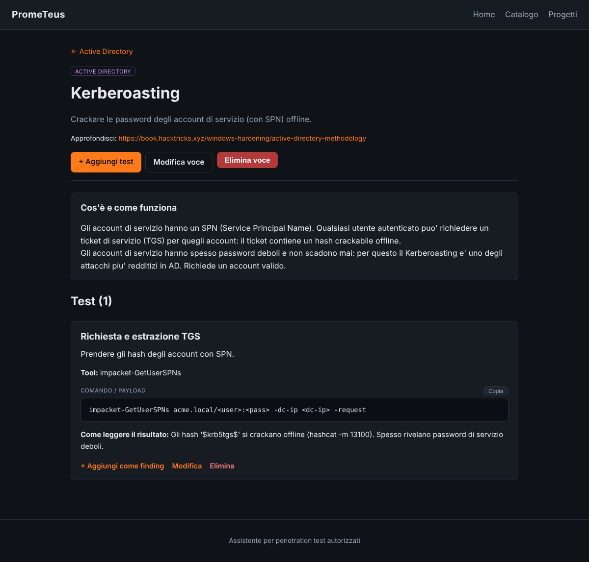
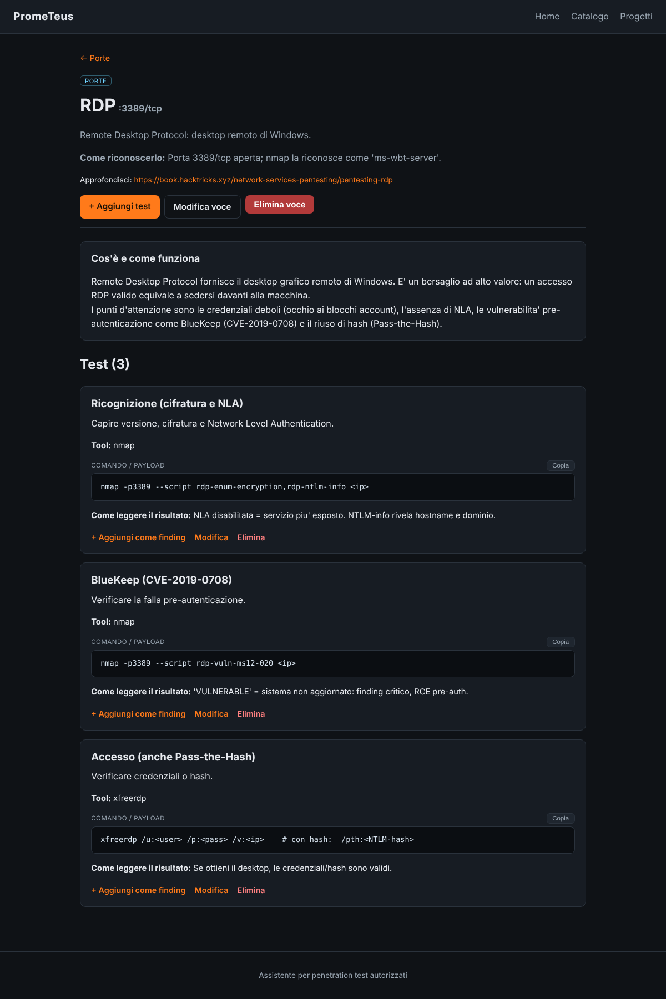
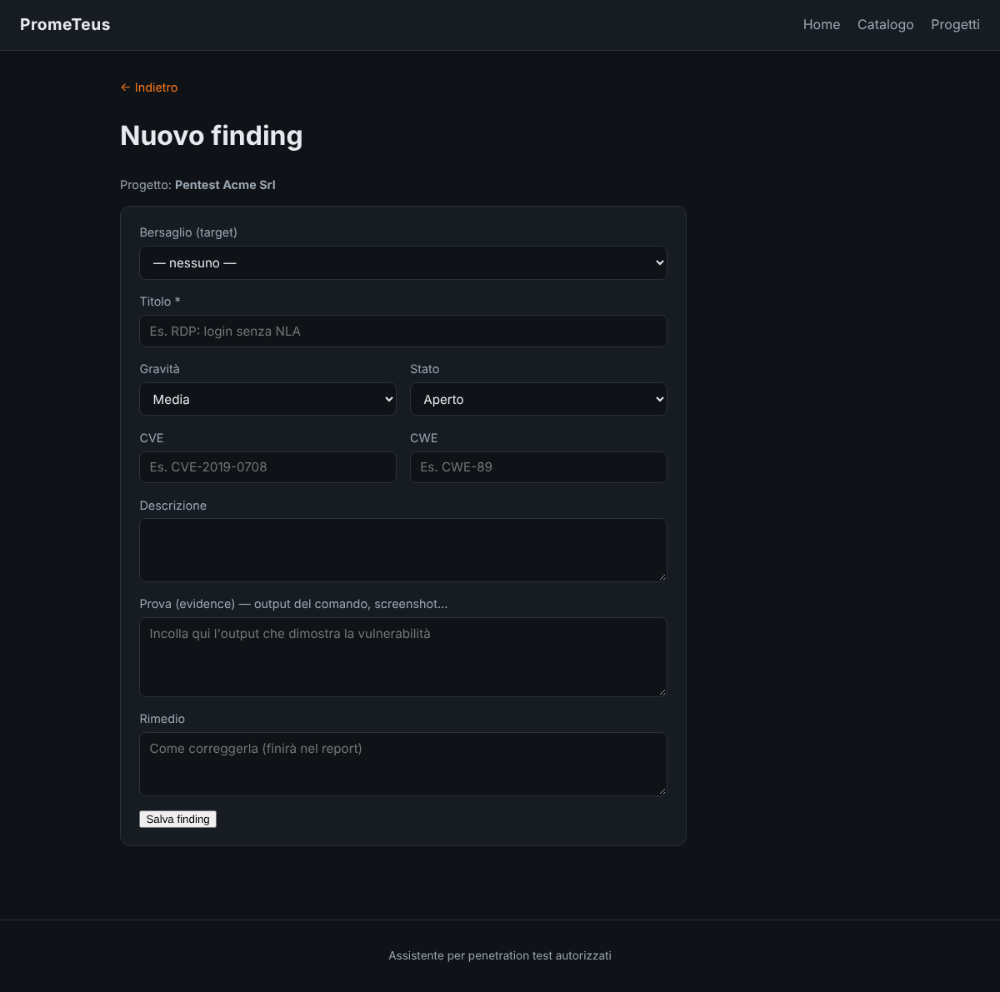
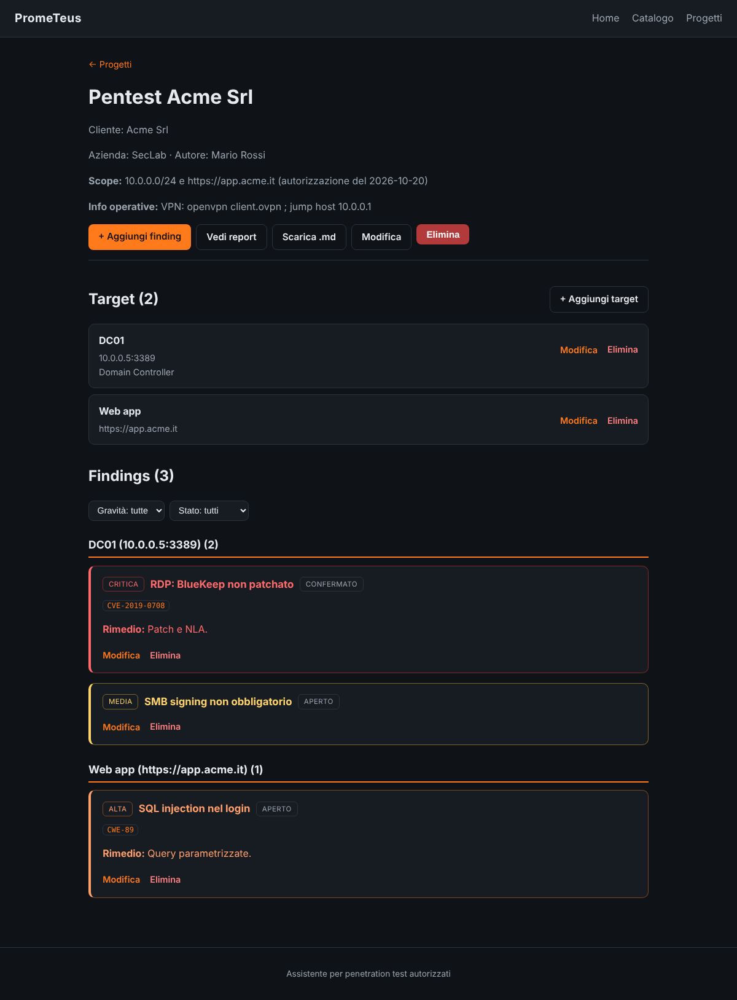
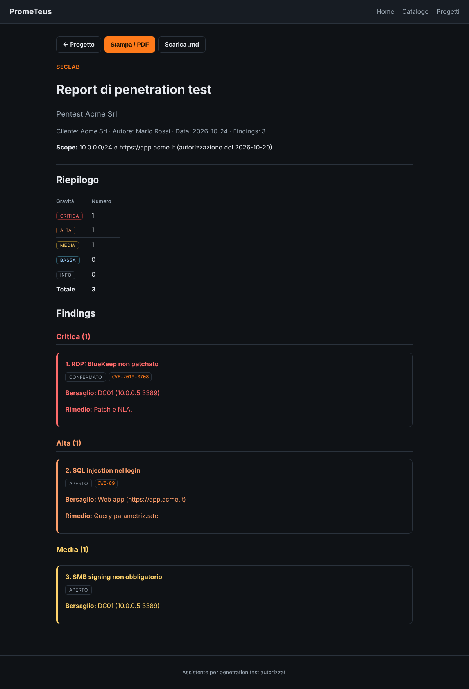

# Guida rapida a PromeTeus

Questa guida ti accompagna nell'uso di PromeTeus passo per passo, con le
immagini di ogni schermata. È pensata per chi parte da zero.

> ⚠️ **Promemoria:** usa PromeTeus solo su sistemi per cui hai
> un'autorizzazione esplicita (ingaggio di pentest, bug bounty in scope,
> laboratori o CTF).

---

## 1. Avvio

- **Windows:** doppio clic su `avvia.bat`
- **macOS / Linux:** esegui `./avvia.sh` da terminale

La prima volta lo script prepara tutto da solo, poi apre il browser su
**http://127.0.0.1:8000**. Per fermarlo: `Ctrl + C`.
(I dettagli e l'avvio manuale sono nel [README](README.md).)

---

## 2. La home

Appena apri PromeTeus trovi il **catalogo**, diviso in cinque sezioni (Porte,
Tecnologie, Tecniche, Active Directory, Web App), e l'area **Progetti &
findings**. Ogni card mostra quante voci contiene.

---

## 3. Il catalogo — *cosa testare*

Il catalogo risponde alla domanda "ho trovato questa cosa, cosa ci faccio?".
È diviso in cinque sezioni, con **ricerca** per nome e **filtri**:

- **Porte** — i servizi di rete (RDP, SMB, SSH…), con tool e comandi;
- **Tecnologie** — es. WordPress → wpscan;
- **Tecniche** — classi di vulnerabilità e payload (SQLi, XSS…), da PayloadsAllTheThings;
- **Active Directory** — metodologia per i domini Windows (enumerazione, Kerberoasting, movimento laterale…);
- **Web App** — come approcciare un test su applicazioni web (ricognizione, autenticazione, injection…).

Le sezioni **Active Directory** e **Web App** ti guidano passo per passo, con i
tool e i comandi più usati:

---

## 4. Una voce e i suoi test

Cliccando una voce (qui **RDP**) trovi in alto un'introduzione **"Cos'è e come
funziona"**, poi per ogni test: l'**obiettivo**, il **comando / payload** (con
il tasto **Copia**), **come leggere il risultato** e il link **Fonte**. Da qui
puoi anche **gestire il catalogo** e trasformare un test in un finding con
**`+ Aggiungi come finding`**.

---

## 5. Creare un progetto

Un **progetto** è un'attività di pentest: raccoglie i target e i findings per
poi generare il report. Da **Progetti → Nuovo progetto** compila:

- **Nome** e **Cliente**;
- **La tua azienda** e **Autore** (vanno nell'intestazione del report);
- **Scope / note**;
- **Info operative** — appunti tuoi (VPN, credenziali, jump host…). Restano
  **privati**: li vedi solo nel progetto, **non** finiscono mai nel report.

---

## 6. Aggiungere i target

Dentro il progetto inserisci una volta sola i **target** (i bersagli): un
host/IP o un URL, con un nome e qualche nota. Usa **`+ Aggiungi target`** nella
sezione *Target*. Così non dovrai più riscriverli: li selezionerai nei findings.

Esempi: `DC01 → 10.0.0.5:3389` (Domain Controller), `Web app → https://app.acme.it`.

---

## 7. Segnare un finding

Quando un test conferma una vulnerabilità, la registri come **finding**. Il
progetto è già fissato: ti basta **selezionare il target** dal menù (niente più
riscrittura), poi indichi titolo, **gravità**, **stato**, **CVE/CWE**,
descrizione, la **prova** (l'output che la dimostra) e il **rimedio**.

---

## 8. Il progetto: target e findings

La pagina del progetto mostra le **info operative**, la lista dei **target** e
tutti i **findings** (ordinati per gravità, col bordo colorato). Su ogni finding
vedi il **bersaglio** preso dal target. Puoi filtrare, modificare o eliminare, e
in alto trovi i pulsanti per il **report**.

---

## 9. Generare il report

Il pulsante **Vedi report** produce il documento finale: intestazione con la tua
azienda e l'autore, un **riepilogo** per gravità, e i findings **raggruppati e
numerati** (ognuno col suo bersaglio). Da lì puoi:

- **Stampa / PDF** (apre la stampa del browser → "Salva come PDF");
- **Scarica .md** per avere il report come file di testo (Markdown).

(Le info operative del progetto **non** compaiono nel report.)

---

## 10. Personalizzare il catalogo

PromeTeus parte con un catalogo già pieno, ma è **tutto tuo**: da
**Catalogo → `+ Nuova voce`** aggiungi le tue porte/tecnologie/tecniche, e dentro
ogni voce i tuoi test con i comandi che usi davvero.

---

## Il flusso tipico, in breve

1. Crei un **progetto** e ci inserisci i **target** (host/URL) una volta sola
2. Trovi qualcosa → cerchi nel **Catalogo** cosa testare e come leggerlo
3. Confermi una vulnerabilità → **finding**, selezionando il **target** giusto
4. A fine attività → **Report** (schermo, PDF o Markdown) da consegnare

Buon lavoro — e ricorda: solo su bersagli **autorizzati**.
